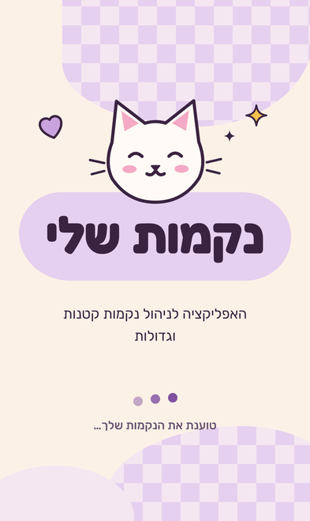
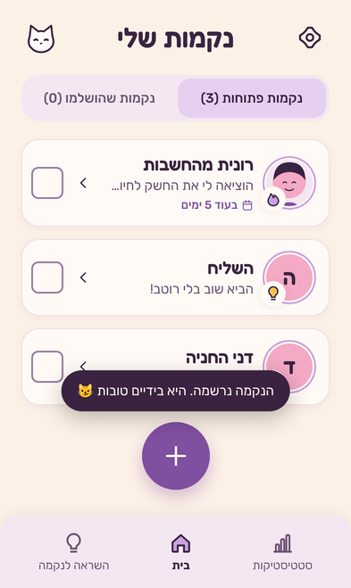
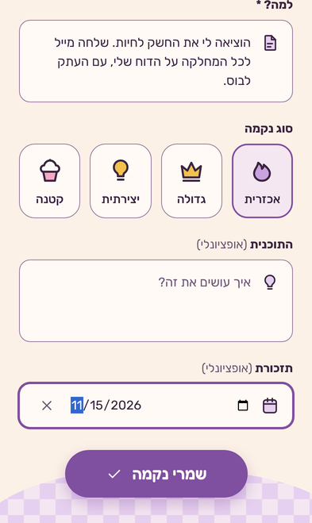
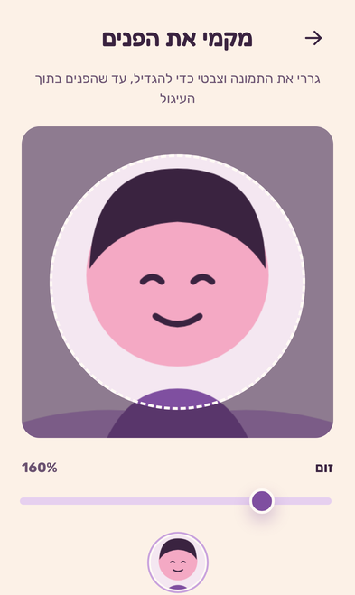
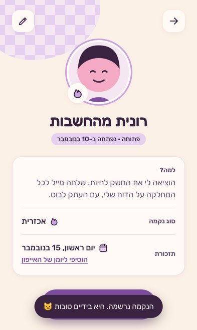
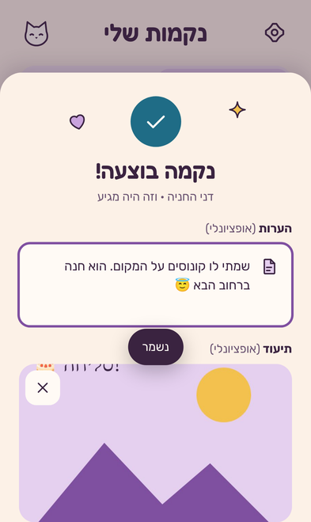
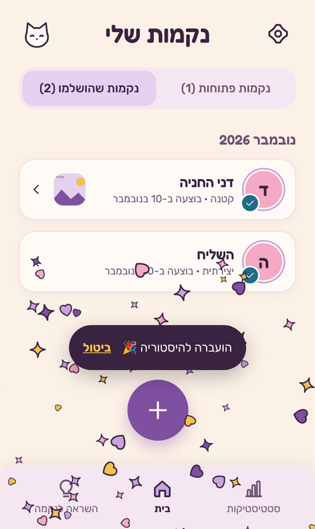
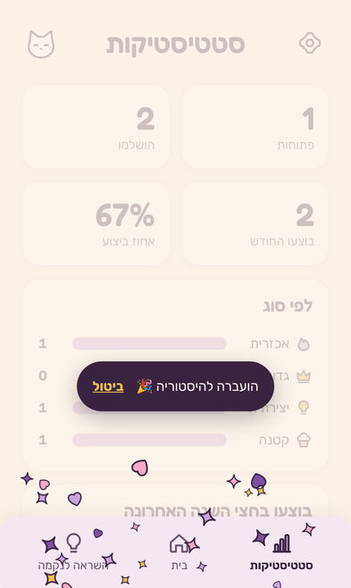
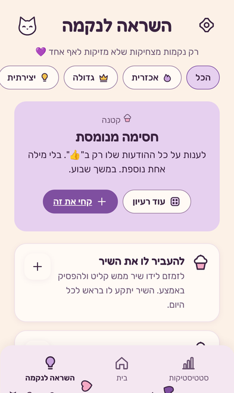
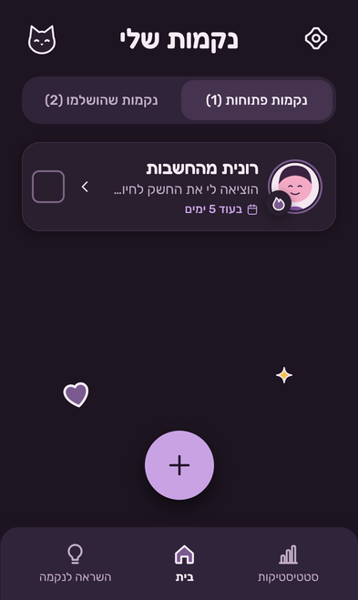

# 🐱 נקמות שלי

האפליקציה לניהול נקמות קטנות וגדולות. רושמים במי נוקמים ולמה, בוחרים סוג נקמה,
מוסיפים תמונה ותזכורת, ומסמנים כבוצעה (עם הערות ותמונת תיעוד). הכל נשמר **בטלפון**, בלי חשבון
ובלי הרשמה, כמו ב"יפן בכיס". אפשר להפעיל **גיבוי וסנכרון בענן**, מוצפן מקצה לקצה, בין כל הטלפונים שלך.

**האפליקציה החיה:** https://guyyyy15-web.github.io/deck-surfers/

### התקנה על האייפון
1. לפתוח את הקישור ב**ספארי**.
2. שיתוף ← **"הוספה למסך הבית"**.
3. מעכשיו היא נפתחת מהאייקון, במסך מלא, וגם בלי אינטרנט.

| פתיחה | בית | נקמה חדשה | מיקום הפנים | פרטי נקמה |
|---|---|---|---|---|
|  |  |  |  |  |
| **השלמה** | **היסטוריה** | **סטטיסטיקות** | **השראה** | **מצב כהה** |
|  |  |  |  |  |

## מה יש בפנים

| מסך | מה עושים בו |
|---|---|
| 🏠 בית | נקמות פתוחות / שהושלמו עם מונים, כרטיס לכל נקמה (תמונה או אות, אייקון הסוג, תזכורת קרובה), ✓ לסימון מהיר, חיפוש כשיש 6 ומעלה |
| ➕ נקמה חדשה | תמונה (אופציונלי), במי נוקמים, למה, סוג (אכזרית / גדולה / יצירתית / קטנה), התוכנית, תזכורת |
| 🎯 מיקום הפנים | גרירה, צביטה וזום עד שהפנים בעיגול, עם תצוגה מקדימה |
| 📄 פרטי נקמה | כל הפרטים, עריכה, מחיקה (עם ביטול), ו"הוסיפי ליומן של האייפון" (קובץ ‎.ics עם התראה ב־9:00) |
| ✅ השלמה | הערות ותמונת תיעוד (מצלמה או גלריה), קונפטי, ובוטל בטעות? "ביטול" |
| 📚 היסטוריה | לפי חודשים, עם תמונת התיעוד וכמה זמן לקח |
| 📊 סטטיסטיקות | פתוחות, הושלמו, החודש, אחוז ביצוע, לפי סוג, חצי שנה אחרונה, "הקבוע/ה" |
| 💡 השראה | 28 רעיונות לנקמות מצחיקות ולא מזיקות, סינון לפי סוג, "עוד רעיון" ו"קחי את זה" שממלא את התוכנית |
| ☁️ גיבוי בענן | בהגדרות: "הפעלת גיבוי בענן" נותן קוד סנכרון. "חיבור טלפון נוסף" משתף קישור; פותחים אותו בטלפון השני והכל מופיע, כולל תמונות. מחיקות ועדכונים עוברים לכל הטלפונים |
| 🐱 החתול שלך | כינוי (עם 🎲 לרעיונות), 6 צבעים ו־8 אביזרים. ככה מופיעים בקבוצות. בלי הרשמה: הזהות היא מפתח בטלפון, ועוברת בגיבוי לטלפון חדש |
| 👥 קבוצות | קבוצה עם לוח משותף: הזמנה בקישור ו"שבועת נקמה", הצעות והצבעות 😈, "אני לוקח/ת!", ביצוע עם תיעוד, צ׳אט ותגובות, ניהול חברים. עד 20 חברים, מוצפן מקצה לקצה |
| 🔔 התראות | כשמישהו בקבוצה מציע, לוקח, מבצע או כותב. מוצפנות: רק הטלפון שלך קורא את הטקסט. השתקה לכל קבוצה, התראת בדיקה, ומספר על האייקון. באייפון: רק כשהאפליקציה מותקנת |
| ⚙️ הגדרות | לשון פנייה (נקבה / זכר), ערכת צבעים (אוטומטי / בהיר / כהה), הוראות התקנה, ייצוא וייבוא גיבוי, מחיקת הכל |

## איך זה בנוי

- **בלי build ובלי תלויות.** HTML, CSS ו־JavaScript מודולרי, ישר מ־GitHub Pages.
- **הנתונים בטלפון:** IndexedDB לנקמות ולתמונות (תמונות פנים 512px, תיעוד עד 1600px, כמו בגלריה של יפן בכיס),
  ו־localStorage רק להגדרות. `navigator.storage.persist()` מבקש מהדפדפן לא למחוק.
- **אופליין:** `sw.js` שומר את כל הקבצים בהתקנה. בכל שינוי מעלים את `VERSION` ב־`sw.js` ואת `APP_VERSION` ב־`js/app.js` (יש טסט שבודק).
- **אייפון:** safe areas, כפתורים של 44px לפחות, שדות בגודל 16px (אין זום), ערכת צבעים לפני הציור הראשון, אייקון apple-touch.
- **סנכרון בענן ([`server/`](server/)):** Cloudflare Worker עם D1 (רשומות) ו־R2 (תמונות), בתוכנית החינמית.
  מקוד הסנכרון (128 ביט) כל טלפון גוזר מזהה, מפתח גישה ומפתח הצפנה AES-GCM. **השרת מקבל רק מידע מוצפן**:
  הוא לא יכול לקרוא שמות, סיבות או תמונות. בלי הקוד אין דרך לשחזר, וזה בכוונה. כשמתנגשים, העדכון האחרון
  לכל נקמה מנצח. השרת מסרב להעלות תמונות לפני שמגיעים ל־8GB, כדי לא לחרוג מה־10GB החינמיים של R2.
- **גיבוי:** קובץ JSON אחד עם הנקמות והתמונות. זו גם הדרך לעבור לטלפון חדש.
- **עיצוב:** לפי קובץ המסכים "נקמות שלי", עם הטוקנים שלו (בהיר וכהה), Fredoka ו־Rubik שמורים מקומית.

```
index.html  manifest.webmanifest  sw.js
css/app.css           עיצוב וטוקנים
js/app.js             מסכים, ניווט, חיתוך תמונה, גיליונות
js/logic.js           לוגיקה טהורה: תאריכים, סטטיסטיקה, ‎.ics, חישובי חיתוך, גיבוי
js/sync.js            סנכרון מוצפן: קוד, מפתחות, שליחה ומשיכה של שינויים
js/identity.js        החתול שלך: כינוי, דמות, ומפתחות החתימה וההצפנה של הטלפון
js/groups.js  js/groups-ui.js   קבוצות: הצפנה, הזמנות, יומן אירועים ומסכים
js/db.js  js/images.js  js/icons.js  js/ideas.js
server/               שרת הסנכרון (Cloudflare Worker + D1 + R2) והבדיקות שלו
tests/                בדיקות יחידה (node --test)
scripts/smoke.cjs     בדיקת קצה לקצה במסך אייפון 15 ואייפון SE, כולל אופליין
game/                 Deck Surfers, המשחק שהיה כאן קודם
```

## הרצה ובדיקות

```bash
npm run serve    # http://localhost:8080/
npm test         # 22 בדיקות יחידה
npm run smoke    # 44 בדיקות בדפדפן במסך אייפון, צילומי מסך ב-screenshots/
npm run icons    # מייצר את ה-PNG מ-icons/icon.svg
node scripts/sync-smoke.cjs   # שני טלפונים מול השרת המקומי: חיבור, תמונות, מחיקות, אופליין
node scripts/groups-smoke.cjs # שלושה טלפונים בקבוצה: הזמנה, הצבעות, ביצוע, צ'אט, הוצאה והחלפת מפתח, והתראות מקצה לקצה

cd server && npm install
npm test         # בדיקות API מול wrangler dev מקומי
npm run deploy   # https://nekamot-sync.guyyyy15-web.workers.dev
```

## תחזוקה ואבטחה

- **CI:** כל דחיפה מריצה ב־GitHub Actions את כל הבדיקות (יחידה, שרת, ושני דפדפנים מסתנכרנים). ראו `.github/workflows/ci.yml`.
- **עדכוני תלויות:** Dependabot פותח בקשות עדכון שבועיות לכלים של השרת.
- **מסד הנתונים:** שינויים רק דרך קבצי מיגרציה ב־`server/migrations/`.
- **אבטחת האפליקציה:** Content Security Policy שמאפשרת קוד רק מהאתר עצמו ותקשורת רק עם שרת הסנכרון.
- **אבטחת השרת:** כותרות אבטחה, CORS רק לכתובת האפליקציה, הגבלת קצב ליצירת גיבויים (10 בשעה לכל כתובת),
  ותקרות נפח שלא מאפשרות חיוב.
- **סודות:** אף מפתח לא נשמר בגיט. המפתחות של Cloudflare ו־Supabase שמורים רק בסביבת הפיתוח.
- כללי העבודה המלאים: [`CLAUDE.md`](CLAUDE.md).

## ומה עם Deck Surfers?

המשחק עבר ל־[`game/`](game/) וממשיך לעבוד:
https://guyyyy15-web.github.io/deck-surfers/game/
